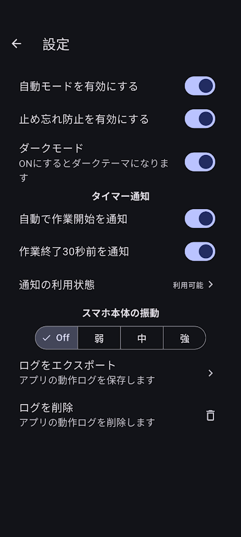

# タイマー通知設定

## 通知の仕組み

ptune の通知をスマホで受け取り、連携設定によりスマートウォッチにも表示します。スマートウォッチへの転送には、対応するスマホとメーカーの連携アプリが必要です。

## ptune とスマホの設定

### 1. ptune で通知を選ぶ

{ width="300" }

「設定」の「タイマー通知」で、必要な通知を ON にします。

| 設定 | 内容 |
| --- | --- |
| 自動で作業開始を通知 | 自動モードでの作業開始を通知します。 |
| 作業終了30秒前を通知 | 作業終了が近いことを通知します。 |
| 通知の利用状態 | スマホ側で通知を利用できる状態か確認します。 |
| スマホ本体の振動 | Off／弱／中／強から選びます。スマートウォッチの振動はスマートウォッチ側で設定します。 |

### 2. スマホで通知を許可する

ptune の「通知の利用状態」を開き、必要に応じてスマホ側の設定を確認します。「利用可能」でも、スマートウォッチへの転送設定は別途必要です。

**Android**

スマホの「設定 → アプリ → ptune → 通知」で「ptune のすべての通知」を ON にします。通知の表示を許可する設定です。

通知カテゴリがある場合は、該当カテゴリも有効にします。「通知ドット」はアイコン上の印なので、任意です。

「アラームとリマインダー」の許可を求められた場合は、ptune の「アラームとリマインダーの設定を許可する」を ON にします。指定時刻に処理を実行するための許可で、通知の表示許可とは別です。

参考：[Android の通知設定](https://support.google.com/android/answer/9079661?hl=ja) ／ [アラームとリマインダーの権限](https://developer.android.com/develop/background-work/services/alarms?hl=ja#exact-permission-declare)

**iPhone**

「設定 → 通知 → ptune」で通知を許可します。時刻指定の通知要約から外し、集中モードを使う場合は ptune の通知を許可します。

参考：[iPhone の通知設定](https://support.apple.com/ja-jp/guide/iphone/iph7c3d96bab/ios)

## スマートウォッチ連携（Garmin の例）

他メーカーでも、連携アプリやスマートウォッチ側で ptune の通知を許可します。設定名は OS・機種・アプリのバージョンにより異なります。

Garmin Connect でスマートウォッチをペアリングし、対象デバイスの「スマート通知」を有効にします。

**Android：Garmin Connect → メニュー → 設定 → 通知 → アプリの通知**を開きます。

ptune だけを転送する場合は、次のように設定します。

| 設定 | 選択 |
| --- | --- |
| 通知 | ON：アプリ通知の転送を有効にします。 |
| すべてのアプリケーション | OFF：転送対象を個別に選びます。 |
| ptune | ON：ptune を転送対象にします。 |

「サイレントモードの動作に従う」は、スマホのサイレント状態を反映する設定です。サイレント時にも受け取りたい場合は OFF を試してください。

**iPhone：**転送するアプリは基本的に iOS の通知設定で管理します。Android と同じアプリ一覧での選択を前提にしません。

参考：[Garmin の通知管理（OS 別）](https://www8.garmin.com/manuals/webhelp/GUID-2C274FD2-F0C3-445C-B0AC-700FECCE12E9/EN-US/GUID-5A95D297-7177-4745-ADAF-AC4855E0B7FA.html)

## 通知が届かない場合

- **スマホにも出ない：**ptune の通知設定とスマホの通知許可、アラームの許可、集中モードなどの通知制限を確認します。
- **スマホには出るがスマートウォッチに出ない：**スマホとスマートウォッチの接続、連携アプリの転送設定・通知アクセス権限、スマートウォッチのおやすみモードを確認します。

参考：[Garmin の通知トラブルシューティング](https://support.garmin.com/en-US/?faq=jusyWiwXtF4512Rb8jnLOA)
